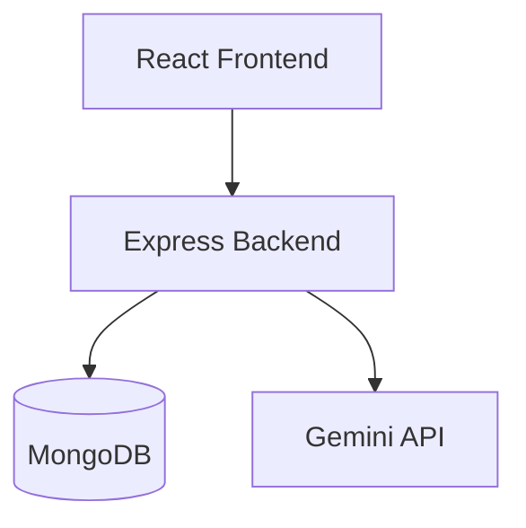

[](https://github.com/amseph/itelect4-backend/actions/workflows/ci.yml)

# Campus Study Room Reservation System - Backend

## About

This is the backend API for the Campus Study Room Reservation System. It handles user authentication, study room data, reservations, and the AI Study Assistant.

## Main Features

- User registration and login
- Study room data
- Reservation management
- AI study-plan review
- Database persistence

## Tech Stack

- Node.js
- TypeScript
- Express
- MongoDB Atlas
- JWT authentication
- Gemini API

## Main API Features

- Authentication
- Study rooms
- Reservations
- AI study-plan review
- Health check at `/api/health`

## Architecture



The frontend sends API requests to the Express backend. The backend stores and retrieves application data from MongoDB. The AI Study Assistant uses Gemini through the backend.

## Environment Variables

- `MONGODB_URI` — MongoDB connection string
- `JWT_SECRET` — used for authentication tokens
- `CORS_ORIGIN` — allowed frontend origin
- `GEMINI_API_KEY` — API key for the AI feature
- `PORT` — local server port (defaults to `4000`)

## Local Setup

1. Install dependencies:

   ```bash
   npm ci
   ```

2. Add the required environment variables to a `.env` file in the project root.
3. Start the local server:

   ```bash
   npm run dev
   ```

Run these commands to test and check the project:

```bash
npm test
npm run typecheck
npm run build
```

## Health Check

Use `/api/health` to check whether the API and database connection are available.

## Live Deployment

- Frontend: https://itelect4-project-chi.vercel.app
- Backend: https://itelect4-backend-flame.vercel.app

## Frontend Repository

https://github.com/amseph/itelect4-project

## AI Use Disclosure

AI tools were used for development assistance, debugging, and code review. All changes were reviewed, tested, and understood by the author.
