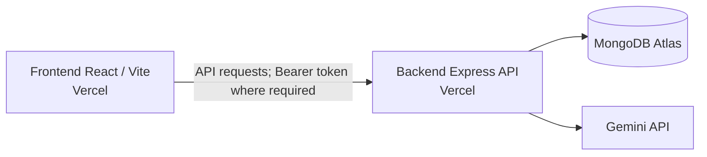

[](https://github.com/amseph/itelect4-backend/actions/workflows/ci.yml)

# Campus Study Room Reservation System - Backend

REST API for the [Campus Study Room Reservation System frontend](https://github.com/amseph/itelect4-project). It provides authentication, study room data, user-scoped reservation management, and an AI study-plan review endpoint.

## Tech Stack

- Node.js and TypeScript
- Express
- MongoDB Atlas with Mongoose
- JWT authentication and bcryptjs password hashing
- CORS and dotenv

## Functionality

- User registration and login with JWT authentication
- Public study room retrieval
- Protected reservation management scoped to the authenticated user
- MongoDB persistence
- CORS configured through `CORS_ORIGIN` for the deployed frontend
- AI study-plan review using Gemini, with authenticated requests and input validation

## API Overview

| Method | Endpoint | Access | Description |
| --- | --- | --- | --- |
| GET | `/api/health` | Public | Reports API and database connection status |
| POST | `/api/auth/register` | Public | Register a user |
| POST | `/api/auth/login` | Public | Log in and receive a JWT |
| POST | `/api/ai` | JWT required | Review a proposed study session and return a study-plan summary, strengths, improvements, and readiness |
| GET | `/api/rooms` | Public | List study rooms |
| GET | `/api/rooms/:id` | Public | Retrieve a study room by numeric ID |
| GET | `/api/reservations` | JWT required | List the authenticated user's reservations |
| GET | `/api/reservations/:id` | JWT required | Retrieve one of the authenticated user's reservations |
| POST | `/api/reservations` | JWT required | Create a reservation for the authenticated user |
| PATCH | `/api/reservations/:id` | JWT required | Update one of the authenticated user's reservations |
| DELETE | `/api/reservations/:id` | JWT required | Delete one of the authenticated user's reservations |

Pass the login token as a bearer token in the `Authorization` header for protected endpoints.

The frontend sends `Authorization: Bearer <token>` for protected API requests, including AI reviews and reservation management.

## Architecture



## Environment Variables

Set the following variables in the environment:

- `MONGODB_URI` — MongoDB connection string
- `JWT_SECRET` — secret used to sign authentication tokens
- `CORS_ORIGIN` — allowed frontend origin or comma-separated origins
- `GEMINI_API_KEY` — API key used for AI study-plan reviews
- `PORT` — local server port (defaults to `4000`)

## Local Development

Install dependencies:

```bash
npm install
```

Create a `.env` file in the project root and set the environment variables listed above. For automated tests, `JWT_SECRET` must be available to the process; tests load local values from `.env` and never connect to MongoDB or Gemini.

Start the development server:

```bash
npm run dev
```

Build the TypeScript project:

```bash
npm run build
```

Seed the study rooms:

```bash
npm run seed
```

## Health Endpoint

`GET /api/health` returns the API and database connection status. A healthy deployed database connection returns:

```json
{"ok":true,"db":true}
```

## Live Deployment

- Frontend: https://itelect4-project-chi.vercel.app
- Backend: https://itelect4-backend-flame.vercel.app

Frontend repository: https://github.com/amseph/itelect4-project

## AI Use Disclosure

AI tools were used for development assistance, debugging, and code review. All changes were reviewed, tested, and understood by the author.
